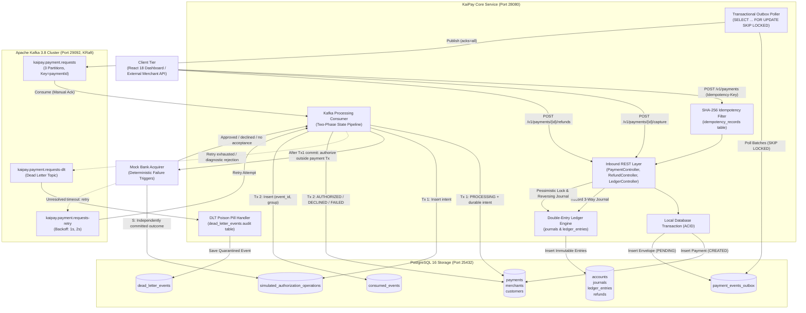

# KaiPay: High-Throughput Distributed Payment & Double-Entry Ledger Engine

[](https://openjdk.org/projects/jdk/21/)
[](https://spring.io/projects/spring-boot)
[-black.svg)](https://kafka.apache.org/)
[](https://www.postgresql.org/)
[](https://testcontainers.com/)
[](https://react.dev/)
[](https://tailwindcss.com/)
[](https://opensource.org/licenses/MIT)

KaiPay is a distributed payment processing and financial accounting engine built with **Java 21**, **Spring Boot 4.1.1**, **Apache Kafka 3.8.0 (KRaft mode)**, and **PostgreSQL 16**. It is engineered to solve core distributed systems consistency and reliability challenges: the distributed dual-write problem, at-least-once message delivery, head-of-line blocking during downstream bank latency, idempotency under uncoordinated retries, and strict double-entry ledger accounting invariants.

---

## 1. Project Overview

KaiPay is a **simulated-payment demo**: no real provider or money movement is supported. Browser and API access requires individually provisioned accounts, server-side sessions and CSRF protection. Merchants are limited to assigned merchants; separate administrators can read operational diagnostics without impersonating merchants. See [demo authentication and access](docs/security.md) for the session handshake, roles and hosting prerequisites.

In payment processing architectures, services must prevent data loss, prevent duplicate customer charges, provide observable lifecycle state, and maintain strict mathematical balance across all accounts—even during network partitions, bank partner outages, pod crash rebalances, and concurrent retries.

KaiPay demonstrates production-style solutions to these engineering challenges:

- **Distributed Dual-Write Elimination**: Combines local database transaction commits with an asynchronous Transactional Outbox poller using PostgreSQL row-level locks (`SELECT ... FOR UPDATE SKIP LOCKED`).
- **Durable Simulated Authorization**: One retained operation per payment validates request equivalence and preserves the simulator outcome across competing calls and restarts. Payment completion and its consumer marker commit atomically. Calls may repeat; this is a simulated-provider guarantee, not a guarantee about real bank charges.
- **Non-Blocking Multi-Topic Retries**: Eliminates consumer partition Head-of-Line blocking via Spring Kafka `@RetryableTopic` with exponential backoff and Dead Letter Topic (`kaipay.payment.requests-dlt`) quarantine.
- **Strict Double-Entry Financial Ledger**: Records all monetary movements via immutable Journal entries and balanced Ledger Entries enforcing $\sum \text{Debits} = \sum \text{Credits}$ with integer minor-unit precision (MYR sen; `BIGINT amount_cents`).
- **Pessimistic Locking on Financial Aggregates**: Guards against concurrent partial and full refund race conditions (`SELECT ... FOR UPDATE`) to prevent over-refunding.
- **Operational Full-Stack Visibility**: Provides an operational administrative interface built with React 18, TypeScript, and Tailwind CSS to observe live outbox buffers, dead-letter events, and ledger journals in real time.

---

## 2. System Architecture



---

## 3. Key Technical Decisions

| # | Technical Challenge | Proposed Solution | Tradeoff Considered |
| :- | :--- | :--- | :--- |
| **1** | **Distributed Dual-Write Problem** | **Transactional Outbox Pattern** with PostgreSQL row-level polling using `SELECT ... FOR UPDATE SKIP LOCKED`. Payment aggregate mutations and event envelopes commit atomically within the local ACID boundary. | Introduces asynchronous event publishing polling latency (~500ms) compared to direct synchronous broker publishing, but eliminates ghost events and uncommitted message leaks without requiring 2PC/XA. |
| **2** | **Consumer Crash Window & Redeliveries** | Short preparation transaction, independently committed durable simulator operation, then atomic payment completion and `consumed_events` marker. Replays validate identity, payload and terminal eligibility. | Repeated calls share one immutable simulated outcome. Automatic recovery depends on retained Kafka deliveries; exhausted or lost deliveries need separately reviewed operator recovery. |
| **3** | **Consumer Head-of-Line (HoL) Blocking** | **Non-Blocking Multi-Topic Retries** using Spring Kafka `@RetryableTopic` with exponential backoff (1s, 2s, max 3 attempts) and automated Dead Letter Topic (`kaipay.payment.requests-dlt`) routing. | Redelivered messages on retry topics consume additional partition bandwidth, but avoid blocking healthy transactions on the primary partition during third-party gateway latency spikes. |
| **4** | **Financial Balance Integrity** | **Immutable Double-Entry Ledger Engine** with standardized chart of accounts and strict zero-sum balancing invariant ($\sum \text{Debits} = \sum \text{Credits}$). Balances are projected from ledger entries. | Balance calculations require SQL aggregate queries over immutable ledger rows rather than reading a single scalar column, but guarantees mathematical consistency and full auditability. |
| **5** | **Concurrent Over-Refund Race Conditions** | **Pessimistic Write Locking (`PESSIMISTIC_WRITE`)** on parent payment records (`SELECT ... FOR UPDATE`) during refund calculation and persistence. | Serializes concurrent refunds for the exact same payment, but prevents concurrent refund requests from exceeding the original captured transaction amount. |

---

## 4. Technology Stack

| Layer / Component | Technology | Version | Purpose & Architectural Rationale |
| :--- | :--- | :--- | :--- |
| **Language** | Java | 21 (LTS) | Virtual threads readiness, pattern matching, record classes, strong type safety |
| **Framework** | Spring Boot | 4.1.1 | Portfolio-grade DI container, Spring Data JPA, Spring Kafka, declarative transactions |
| **Message Broker** | Apache Kafka | Client 4.2.1; dev broker 3.8.0 (KRaft) | High-throughput distributed log, partition ordering, KRaft consensus (ZooKeeper-less) |
| **Database** | PostgreSQL | 16-alpine | ACID relational integrity, `SKIP LOCKED` row queuing, partial indexes, atomic constraints |
| **Schema Migration**| Flyway | 12.4.0 | Version-controlled relational database migrations (V1 through V9) |
| **Integration Testing**| Testcontainers | 2.0.5 | Ephemeral Docker containers for PostgreSQL 16 and Kafka 4.1.2 |
| **Frontend Framework**| React | 18.3.1 | Declarative component UI for operational payments, double-entry ledger, outbox & DLT views |
| **Build Tool** | Vite | 6.1.0 | Fast ESM development server and optimized TypeScript bundling |
| **Type System** | TypeScript | 5.7.3 | Strict type safety for API contracts, event payloads, and ledger journal models |
| **Styling** | Tailwind CSS | 3.4.17 | Modern utility-first CSS design system |
| **Icons** | Lucide React | 0.475.0 | Clean financial and operational telemetry icon set |

The backend uses Spring Boot 4.1.1 dependency management (Spring Framework 7.0.9, Security 7.1.1, Spring Kafka 4.1.1 and Hibernate 7.4.5.Final). Kafka clients 4.2.1 retain the producer corruption security fix. Java 21 and migrations V1–V9 are unchanged. Boot's supported Jackson 2 compatibility module preserves existing API and persisted JSON contracts; this deprecated integration will require migration before its future removal. The development Compose broker remains 3.8.0; it is not a supported hosting recommendation.

---

## 5. Core Features

- **Payment Lifecycle**: Finite state machine supporting `CREATED`, `PROCESSING`, `AUTHORIZED`, `CAPTURED`, `REFUND_PENDING`, `PARTIALLY_REFUNDED`, `REFUNDED`, `DECLINED`, and `FAILED`. DLT routing alone does not fail a payment or establish a business decline.
- **Cryptographic Request Idempotency**: SHA-256 hashing across HTTP request payload, headers, and paths to prevent duplicate submissions while safely returning cached responses on retries.
- **Transactional Outbox Worker**: Background poller (`fixedDelay = 500ms`, batch size = 20) with `SKIP LOCKED` row claiming, publishing events to Kafka with manual synchronous acknowledgments.
- **Resilient Kafka Processing**: Partition-key routing on `paymentId`, manual immediate consumer offset acknowledgment, and non-blocking retry topics.
- **Poison Pill & Failure Simulation**: Deterministic amount-based triggers in `MockBankAcquirerClient`:
  - **`RM8,888.00`**: Transient gateway timeout on attempts 1 & 2, succeeds on attempt 3 via retry topic.
  - **`RM7,777.00`**: Persistent gateway timeout exhausting the delivery's 3 attempts and routing to DLT; payment remains `PROCESSING` with unresolved durable evidence.
  - **`RM6,666.00`**: Durable definitive no-acceptance result; atomically finalizes `FAILED` and a consumer marker before non-retryable diagnostic routing to DLT.
  - **`RM9,999.00`**: Business decline (`INSUFFICIENT_FUNDS`), transitioning payment to `DECLINED`.
- **Double-Entry Financial Ledger**: Multi-tenant chart of accounts, 3-way capture journal posting, reversing refund journals, simulated pro-rata fee retention (30 sen fixed fee retained on full refunds).
- **Merchant Access**: Persisted user memberships authorize requested merchant context; resource ownership checks scope payments, refunds, balances and journals. Administrators have separate diagnostic access.
- **Interactive Operations UI**: Real-time management dashboards, visual state machine steppers, outbox queue inspectors, DLT payload viewers, and double-entry ledger explorers.

Simulator outcomes and evaluation counts live in PostgreSQL; a retry, event ID or consumer group cannot create a second authorization identity for a payment. New simulated financial activity supports only MYR using integer sen (100 sen = RM1.00). The existing `amountCents` / `amount_cents` names mean sen for MYR. Currency must exactly match the stored payment. Authorization recovery never captures, refunds or posts ledger entries. DLT is evidence-only; there is no recovery scheduler, automatic DLT replay, terminal-state reopening or real-provider integration.

Historical financial rows retain their original currency and amount; they are never converted or relabeled. Exact stored idempotent responses and historical authorization evidence remain replayable without new activity. New capture/refund, authorization intent and unresolved simulator evaluation require MYR. A conflicting historical account is preserved and blocks new posting through that identity; no automatic account migration is provided. Balance KPI projections cover MYR only; journal/payment/refund history displays its original units, and mixed-currency journal totals are unavailable. Legacy deliveries without currency retain their original USD interpretation and must match stored evidence. V9 changes only defaults for future omitted account/entry/refund currencies; apply upgrades separately under operator control.

**V8 upgrade compatibility:** stop all old application writers/listeners before applying the additive schema and starting the updated application; mixed old/new recovery writers are unsupported. Retain operations with their payments, and never reuse payment UUIDs or purge outcome rows independently. Existing final payments can be handled without inventing provider history; historical `PROCESSING` payments without a durable operation are quarantined for separate operator review. New `CREATED` payments can enter the durable path. Rolling back to the old memory-based simulator after new operations begin is unsafe. Source publication does not apply a migration or deploy the application.

---

## 6. System Flows & Accounting Model

### 6.1. Payment Processing Lifecycle Flow

```
1. Client submits POST /v1/payments (with Idempotency-Key & X-Merchant-Id).
2. IdempotencyFilter checks idempotency_records (SHA-256 hash validation).
3. PaymentService starts Local DB Tx:
   - Persists Payment aggregate (status = CREATED).
   - Persists EventEnvelope<PaymentInitiatedEvent> in payment_events_outbox (status = PENDING).
   - Commits Local DB Tx.
4. OutboxEventPublisher polls pending events using SELECT ... FOR UPDATE SKIP LOCKED:
   - Emits message to Kafka topic 'kaipay.payment.requests' (partition key = paymentId).
   - Updates outbox record (status = PUBLISHED, published_at = NOW()).
5. PaymentProcessingConsumer receives event:
   - Validates the delivery against stored payment identity, amount, currency and retained evidence.
   - Tx1: Locks the payment; creates durable simulator intent and transitions CREATED to PROCESSING atomically, or validates recovery eligibility.
   - After Tx1 commits, calls MockBankAcquirerClient.authorize(...) outside a payment transaction.
   - S: The simulator independently commits its operation evaluation/outcome before returning or throwing a timeout.
   - Tx2: Validates the definitive stored outcome; commits AUTHORIZED (approval), DECLINED (business decline), or FAILED (definitive no acceptance), with consumed_events atomically.
   - An unresolved timeout leaves PROCESSING and has no completion marker; retained Kafka deliveries drive automatic retries. DLT records diagnostic evidence only.
   - Manually acknowledges Kafka consumer offset.
```

---

### 6.2. Double-Entry Accounting Model (Capture & Refund)

KaiPay enforces the strict double-entry balance invariant:
$$\sum \text{Debits} = \sum \text{Credits}$$

#### Chart of Accounts
- **`1000-CUSTOMER-RECEIVABLE`** (Type: `ASSET`): Represents simulated customer funds receivable.
- **`2000-MERCHANT-{ID}-LIABILITY`** (Type: `LIABILITY`): Represents simulated platform liability to the merchant.
- **`4000-PLATFORM-FEE-REVENUE`** (Type: `REVENUE`): Platform transaction fee revenue.

#### Capture Fee Policy
- $\text{FeeCents} = \min\big(\text{GrossAmount}, \; \text{round}(\text{GrossAmount} \times 2.9\%) + 30\big)$
- $\text{NetMerchantCents} = \text{GrossAmount} - \text{FeeCents}$

#### Refund Fee Policy
- Variable processing fee (2.9%) is refunded proportionally: $\text{FeeRefundCents} = \text{round}(\text{RefundAmount} \times 2.9\%)$.
- The fixed simulated fee (30 sen / RM0.30) is retained on refunds. This is a demonstration formula, not actual Malaysian provider, interchange or network pricing.
- On a 100% full refund of a single transaction, the merchant's net position is -RM0.30.
- Across two consecutive fully refunded transactions, the merchant's net position is -RM0.60.

#### Exact Capture & Refund Journal Entries (RM120.00 Capture, RM40.00 Partial Refund, RM80.00 Remaining Refund)

```
====================================================================================================
1. Payment Capture (RM120.00 MYR)
   - Gross Amount: RM120.00 | Fee (2.9% + RM0.30): RM3.78 | Net Merchant: RM116.22
----------------------------------------------------------------------------------------------------
Account                                    Type        Debit (MYR)         Credit (MYR)
----------------------------------------------------------------------------------------------------
1000-CUSTOMER-RECEIVABLE                   ASSET       RM 120.00            -
2000-MERCHANT-LIABILITY                    LIABILITY   -                   RM 116.22
4000-PLATFORM-FEE-REVENUE                  REVENUE     -                   RM   3.78
----------------------------------------------------------------------------------------------------
SUBTOTAL:                                              RM 120.00            RM 120.00 (BALANCED)

====================================================================================================
2. Partial Refund (RM40.00 MYR)
   - Refund Amount: RM40.00 | Fee Refund (2.9%): RM1.16 | Net Merchant Debit: RM38.84
----------------------------------------------------------------------------------------------------
Account                                    Type        Debit (MYR)         Credit (MYR)
----------------------------------------------------------------------------------------------------
2000-MERCHANT-LIABILITY                    LIABILITY   RM  38.84            -
4000-PLATFORM-FEE-REVENUE                  REVENUE     RM   1.16            -
1000-CUSTOMER-RECEIVABLE                   ASSET       -                   RM  40.00
----------------------------------------------------------------------------------------------------
SUBTOTAL:                                              RM  40.00            RM  40.00 (BALANCED)

====================================================================================================
3. Full Remaining Refund (RM80.00 MYR)
   - Refund Amount: RM80.00 | Fee Refund (2.9%): RM2.32 | Net Merchant Debit: RM77.68
----------------------------------------------------------------------------------------------------
Account                                    Type        Debit (MYR)         Credit (MYR)
----------------------------------------------------------------------------------------------------
2000-MERCHANT-LIABILITY                    LIABILITY   RM  77.68            -
4000-PLATFORM-FEE-REVENUE                  REVENUE     RM   2.32            -
1000-CUSTOMER-RECEIVABLE                   ASSET       -                   RM  80.00
----------------------------------------------------------------------------------------------------
SUBTOTAL:                                              RM  80.00            RM  80.00 (BALANCED)

====================================================================================================
FINAL LIFECYCLE RECONCILIATION
- Total Customer Receivable Debits (RM120.00) == Total Customer Receivable Credits (RM40.00 + RM80.00) = RM0.00
- Merchant Payable Balance: Credit RM116.22 - Debit RM38.84 - Debit RM77.68 = -RM0.30 (Fixed fee retained)
- Platform Revenue Balance: Credit RM3.78 - Debit RM1.16 - Debit RM2.32 = +RM0.30 (Platform earned revenue)
====================================================================================================
```

---

## 7. Visual Portfolio Assets

Screenshots capture earlier local simulation sessions and may show historical USD labels; current new activity uses MYR:

### 7.1. Financial Analytics & Operational Telemetry Dashboard

*Real-time financial KPI cards showing available simulated balance (historical screenshot: USD77.38 after fee retention), gross volume, platform fees, operational buffers, and recent transactions with live status badges.*

---

### 7.2. Payment State Machine & Lifecycle Management

*Interactive state machine visualization tracking progression through `CREATED` $\to$ `PROCESSING` $\to$ `AUTHORIZED` $\to$ `CAPTURED` $\to$ `PARTIALLY_REFUNDED`, displaying cryptographic idempotency headers and refund history.*

---

### 7.3. Double-Entry Financial Ledger & Balanced Journals

*Multi-account ledger explorer showing immutable journal entries, real-time balance projections, and strict $\sum \text{Debits} = \sum \text{Credits}$ balance verification.*

---

### 7.4. Transactional Outbox Stream Monitor

*Live outbox monitor displaying pending vs. published event states, payload envelopes, and row claim coordination.*

---

### 7.5. Dead Letter Topic (DLT) & Poison Pill Graveyard

*Operational quarantine inspector displaying dead-lettered events, original partition/offset positions, retry attempt counts, and Java exception stack traces.*

---

## 8. Running the Project

### Dedicated Port Map

KaiPay uses strictly dedicated host ports to ensure total isolation from other host services:

| Service | Container / Process | Host Port | Internal Port | Environment / Connection String |
| :--- | :--- | :--- | :--- | :--- |
| **KaiPay Backend API** | Spring Boot | **`28080`** | `28080` | `http://localhost:28080` |
| **KaiPay Frontend UI** | Vite / React | **`28081`** | `28081` | `http://localhost:28081` |
| **KaiPay PostgreSQL** | Docker (`postgres:16-alpine`) | **`25432`** | `5432` | `jdbc:postgresql://localhost:25432/kaipay` |
| **KaiPay Apache Kafka** | Docker (`apache/kafka:3.8.0`) | **`29092`** | `9092` | `localhost:29092` |
| **KaiPay Kafka-UI** | Docker (`provectuslabs/kafka-ui`) | **`28048`** | `8080` | `http://localhost:28048` |
| **KaiPay Redis (Reserved)**| Docker (`redis:7-alpine`) | **`26379`** | `6379` | `localhost:26379` |

---

### Prerequisites
- **JDK 21** installed.
- **Node.js 18+** and **npm** installed.
- **Docker** and **Docker Compose** running.

---

### Step 1: Start Infrastructure (PostgreSQL, Kafka, Kafka-UI)
From the repository root:
```bash
docker compose up -d
```
Verify container status:
```bash
docker compose ps
```

---

### Step 2: Build & Start Backend Application
```bash
cd backend
./mvnw clean spring-boot:run -Dspring-boot.run.profiles=local
```
*The explicit local profile binds the API to loopback on port `28080` for HTTP development, while keeping authentication and CSRF enabled. Flyway runs V1–V7. No login accounts are seeded: provision individual accounts using [operator commands](backend/README.md) before signing in. Ordinary deployment configuration requires explicit database/broker settings and Secure cookies.*

---

### Step 3: Start Frontend Dashboard
```bash
cd frontend
npm install
npm run dev
```
*The management dashboard will be available at `http://localhost:28081`.*

---

### Step 4: Verify Live Operational Endpoints
- **Frontend Dashboard**: [http://localhost:28081](http://localhost:28081)
- **Kafka-UI Management Console**: [http://localhost:28048](http://localhost:28048)
- **Merchant Balance Endpoint**: `GET http://localhost:28080/v1/ledger/balance` (requires an authenticated merchant session and assigned `X-Merchant-Id`)
- **Transactional Outbox Event Stream**: `GET http://localhost:28080/v1/events/outbox` (ADMIN session)
- **Dead Letter Topic (DLT) Events**: `GET http://localhost:28080/v1/events/dlt` (ADMIN session)

---

## 9. Automated Testing Strategy

KaiPay is verified by an automated test suite comprising **180 automated tests** across 40 test classes:

```text
-------------------------------------------------------
 T E S T S   S U M M A R Y
-------------------------------------------------------
Tests run: 180, Failures: 0, Errors: 0, Skipped: 0
Build Result: SUCCESS
Total Time: 49.350 s
-------------------------------------------------------
```

### Test Classification

1. **Unit & Invariant Tests (POJOs & Core Domain Logic)**:
   - FSM state transition validation (`PaymentStateMachineUnitTest`)
   - Double-entry debit/credit zero-sum mathematical validation (`LedgerServiceUnitTest`, `MerchantBalanceServiceUnitTest`)
   - Structured JSON envelope serialization and deserialization (`EventEnvelopeUnitTest`)
2. **PostgreSQL Integration Tests (Testcontainers PostgreSQL 16)**:
   - Flyway migration execution and relational constraints (V1–V5)
   - SHA-256 API idempotency conflicts and duplicate suppression (`PaymentIntegrationTest`)
   - Pessimistic write locking concurrency across 10 concurrent threads (`RefundIntegrationTest`, `LedgerFinancialInvariantsIntegrationTest`)
   - Journal creation, balance projection queries, and over-refund prevention
3. **Kafka Event-Driven Integration Tests (Testcontainers Kafka 3.8 KRaft)**:
   - Transactional outbox polling and publishing during broker network outages (`OutboxKafkaOutageIntegrationTest`)
   - Consumer deduplication under forced message redeliveries (`PaymentDeduplicationIntegrationTest`, `PaymentGatewayRedeliveryIntegrationTest`)
   - Head-of-line blocking avoidance across multi-partition workloads (`PaymentHeadOfLinePartitionIntegrationTest`)
   - Non-blocking retries with exponential backoff and DLT routing (`PaymentTransientRetryIntegrationTest`, `PaymentPoisonPillAndDltIntegrationTest`)

To execute the automated test suite locally:
```bash
cd backend
./mvnw test
```

---

## 10. Project Directory Layout

```
KaiPay/
├── backend/                             # Spring Boot 4.1.1 Core Service (Java 21)
│   ├── src/main/java/com/lky/kaipay/
│   │   ├── common/                      # EventEnvelope, Base DTOs, Kafka & DB Config
│   │   ├── consumer/                    # Deduplication service & consumed_events tracking
│   │   ├── customer/                    # Customer entity & repository
│   │   ├── dlt/                         # DLT admin controller, entity & repository
│   │   ├── ledger/                      # Double-entry ledger service, journals, accounts
│   │   ├── merchant/                    # Merchant tenant entity, controller & API key auth
│   │   ├── outbox/                      # Transactional outbox publisher & admin controller
│   │   ├── payment/                     # Payment aggregate, FSM, consumer & acquirer client
│   │   └── refund/                      # Refund service, controller, and pessimistic locking
│   ├── src/main/resources/
│   │   ├── application.yaml             # Dedicated ports & Kafka/Postgres config
│   │   └── db/migration/                # Flyway migrations V1 through V5
│   └── src/test/java/                   # 180 Automated Unit & Testcontainers tests
├── frontend/                            # React 18 / TypeScript Operational Dashboard
│   ├── src/
│   │   ├── api/                         # Typed REST API clients (payment, ledger, outbox, dlt)
│   │   ├── components/                  # Navigation layout, sidebar, modal inspectors
│   │   ├── models/                      # TypeScript models for payments, ledger, outbox, dlt
│   │   ├── pages/                       # Dashboard, Payment Details, Ledger, Outbox, DLT
│   │   ├── App.tsx                      # Route declarations
│   │   └── main.tsx                     # React root & TanStack Query client setup
│   ├── package.json                     # React 18.3, Vite 6.1, Tailwind CSS 3.4
│   └── vite.config.ts                   # Port 28081 configuration & proxy rules
├── docker-compose.yml                   # Postgres 16 (25432), Kafka 3.8 (29092), Kafka-UI (28048)
├── docs/                                # Technical documentation suite
│   ├── architecture-reality-check.md    # Source-linked implementation review
│   ├── event-catalog.md                 # Domain event schemas and topic topology
│   ├── failure-handling-and-retries.md  # Non-blocking retries, DLT, and deduplication
│   ├── double-entry-ledger.md           # Accounting proofs and balance projections
│   ├── engineering-benchmark.md         # Architectural tradeoffs and improvement proposals
│   ├── engineering-journal-...md        # Engineering post-mortem & distributed systems lessons
│   └── screenshots/                     # 5 real high-resolution screenshots from live UI
├── .env.example                         # Environment variable configuration template
├── .gitignore                           # Git hygiene configuration
└── LICENSE                              # MIT License
```

---

## 11. Public Documentation Catalog

For implementation reviews, event contracts, accounting models, and engineering tradeoffs, refer to the public documents in [`docs/`](docs/):

| Document | Description |
| :--- | :--- |
| **[Architecture Reality Check](docs/architecture-reality-check.md)** | Source-linked review of implementation behavior, transaction boundaries, and limitations. |
| **[Domain Event Catalog](docs/event-catalog.md)** | Formal schema specifications for `EventEnvelope<T>`, domain events, topic topologies, and serialization rules. |
| **[Failure Handling & Non-Blocking Retries](docs/failure-handling-and-retries.md)** | Failure taxonomy, Spring Kafka `@RetryableTopic` + `@DltHandler` mechanics, and consumer deduplication algorithms. |
| **[Double-Entry Financial Ledger](docs/double-entry-ledger.md)** | Chart of accounts, mathematical balance proofs ($\sum \text{Debits} = \sum \text{Credits}$), 3-way journals, and balance queries. |
| **[Engineering Benchmark](docs/engineering-benchmark.md)** | Architectural tradeoffs, current limitations, and proposed improvements. |
| **[Engineering Journal & Lessons Learned](docs/engineering-journal-lessons-learned.md)** | Detailed engineering post-mortem on dual-write traps, `SKIP LOCKED` tuning, and consumer crash recovery. |

---

## 12. License

This project is licensed under the MIT License. See [LICENSE](LICENSE) for details.
