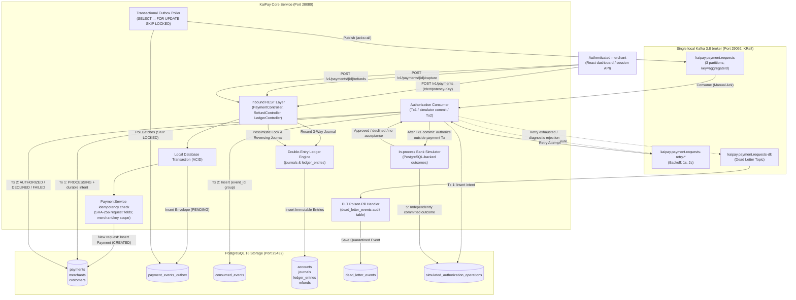
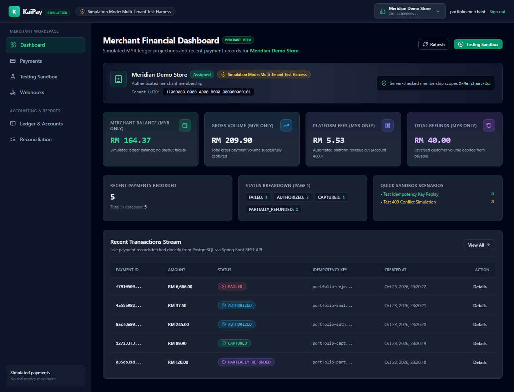
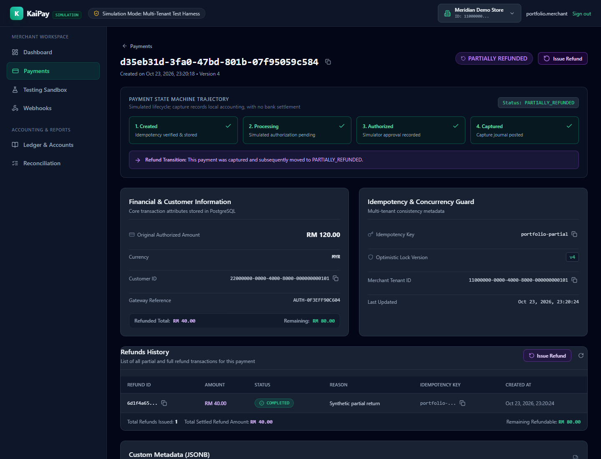
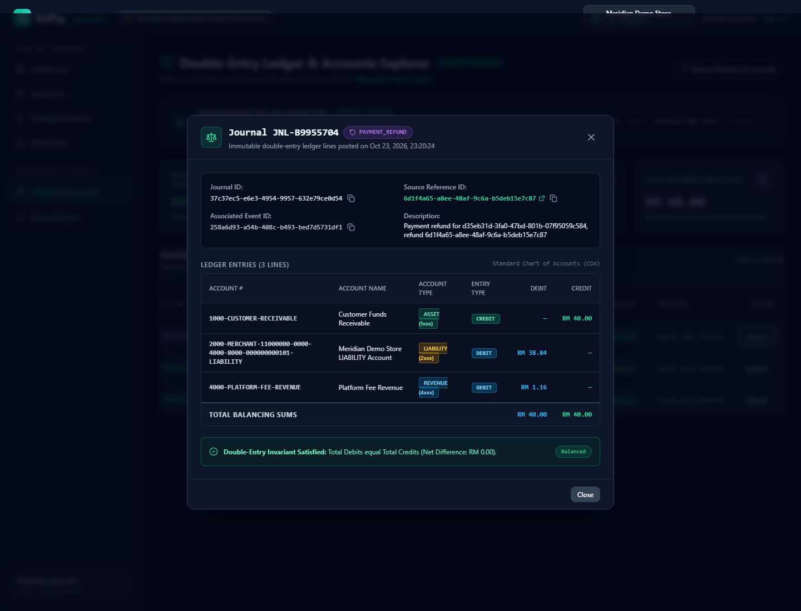
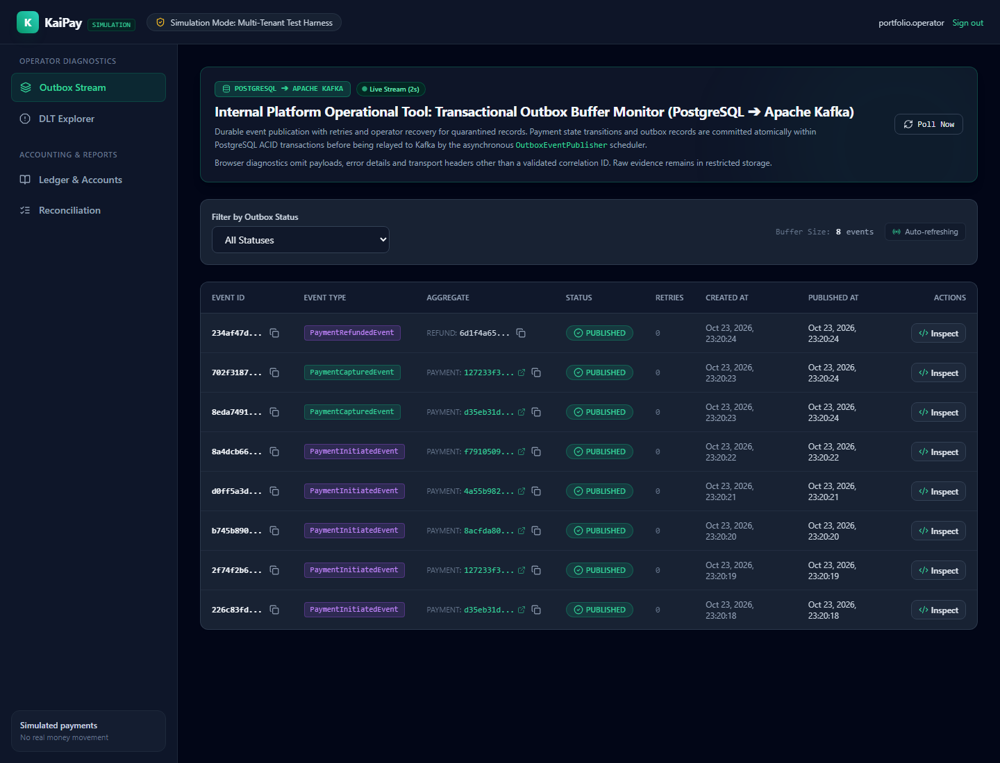
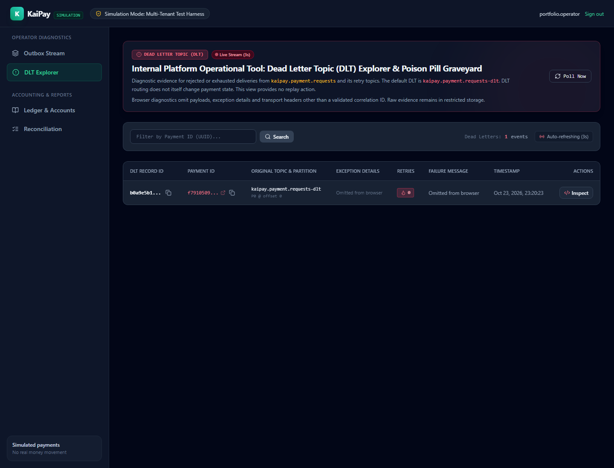

# KaiPay: Simulated Payments & Double-Entry Ledger

[](https://openjdk.org/projects/jdk/21/)
[](https://spring.io/projects/spring-boot)
[-black.svg)](https://kafka.apache.org/)
[](https://www.postgresql.org/)
[](https://testcontainers.com/)
[](https://react.dev/)
[](https://tailwindcss.com/)
[](https://opensource.org/licenses/MIT)

KaiPay is a portfolio payment simulation built with **Java 21**, **Spring Boot 4.1.1**, **PostgreSQL 16** and **Kafka**, with a React merchant dashboard and separate administrator diagnostics. One backend application demonstrates asynchronous authorization, idempotent requests, durable simulator recovery and double-entry capture/refund accounting. New activity uses **MYR, in integer sen** (100 sen = RM1.00).

---

## 1. Project Overview

KaiPay is a **simulated-payment demo**: no real provider or money movement is supported. Browser and API access requires individually provisioned accounts, server-side sessions and CSRF protection. Merchants are limited to assigned merchants; separate administrators can read operational diagnostics without impersonating merchants. See [demo authentication and access](docs/security.md) for the session handshake, roles and hosting prerequisites.

**Current availability:** a supervised local demonstration has exercised merchant payment/capture/refund flows, role boundaries and stored authorization reports. There is no hosted public demo; Oracle hosting is postponed. External webhook delivery remains disabled. This project does not move real money, integrate with a bank, or establish throughput, availability or security-certification guarantees.

| Capability | Current boundary | Evidence / guide |
| :--- | :--- | :--- |
| Merchant workflows | Implemented; individually provisioned accounts, assigned merchants, session/CSRF protection | [Access model](docs/security.md), [frontend routes](frontend/src/App.tsx) |
| Authorization and recovery | Durable local simulator; retries depend on retained Kafka deliveries | [Recovery service](backend/src/main/java/com/lky/kaipay/payment/service/AuthorizationRecoveryService.java), [failure handling](docs/failure-handling-and-retries.md) |
| Capture, refunds and MYR ledger | Implemented synchronous local accounting; no settlement or payout service | [Accounting model](docs/double-entry-ledger.md) |
| Signed webhooks | Durable signed notifications and read-only merchant history; external dispatch disabled, local test evidence only | [Webhook contract](docs/webhooks.md) |
| Authorization reconciliation | Manual operator-created, stored reports; merchant/admin read-only views | [Reconciliation contract](docs/reconciliation.md) |
| Internal accounting audit | Standalone read-only operator CLI; transient JSON, no API/UI or repair | [Accounting audit contract](docs/internal-accounting-audit.md) |

For a first visit, follow the [local demonstration walkthrough](docs/local-demo.md). For transaction boundaries and limits, start with the [source-linked architecture review](docs/architecture-reality-check.md).

KaiPay demonstrates production-style solutions to these engineering challenges:

- **Transactional Outbox**: Commits payment changes and event intent together, then relays to Kafka using PostgreSQL row locks (`SELECT ... FOR UPDATE SKIP LOCKED`). Broker acceptance and the published marker are separate commits; duplicates remain possible.
- **Durable Simulated Authorization**: One retained operation per payment validates request equivalence and preserves the simulator outcome across competing calls and restarts. Payment completion and its consumer marker commit atomically. Calls may repeat; this is a simulated-provider guarantee, not a guarantee about real bank charges.
- **Non-Blocking Multi-Topic Retries**: Moves retryable failures to delayed retry topics (1s, 2s; three delivery attempts), allowing the primary partition to continue after a failed call. The synchronous call itself still occupies its listener thread; retry topics can reorder messages. Exhausted deliveries reach `kaipay.payment.requests-dlt`.
- **Double-Entry Financial Ledger**: Capture/refund workflows append journals and validate balanced entries ($\sum \text{Debits} = \sum \text{Credits}$) using integer minor units (MYR sen; `BIGINT amount_cents`). Privileged database writes remain outside that application invariant.
- **Pessimistic Locking on Financial Aggregates**: Guards against concurrent partial and full refund race conditions (`SELECT ... FOR UPDATE`) to prevent over-refunding.
- **Role-Scoped Visibility**: Merchants see their payments, ledger, webhook history and stored authorization reports. Administrators read outbox/DLT diagnostics, global journals and explicitly scoped authorization reports. Browser diagnostics omit raw payloads and exception details.

---

## 2. System Architecture



The diagram focuses on payment execution. Capture/refund state, ledger rows and lifecycle outbox events commit synchronously; their Kafka notifications are acknowledged without another authorization call. Payment events use payment ID, refund events use refund ID: there is no shared payment/refund partition-order guarantee. The separate [webhook pipeline](docs/webhooks.md) stores notification intent atomically with eligible lifecycle transitions; it is not dispatched by this Kafka authorization consumer. Both read-only assessment tools are described in the capability table above.

---

## 3. Key Technical Decisions

| # | Technical Challenge | Implemented Approach | Tradeoff Considered |
| :- | :--- | :--- | :--- |
| **1** | **Distributed Dual-Write Problem** | **Transactional Outbox Pattern** with PostgreSQL row-level polling using `SELECT ... FOR UPDATE SKIP LOCKED`. Payment aggregate mutations and event envelopes commit atomically within the local ACID boundary. | Default 500ms fixed delay is configuration, not a latency guarantee. Sends wait synchronously while DB locks are held; retries can reorder delivery and a crash after broker acceptance can duplicate events. |
| **2** | **Consumer Crash Window & Redeliveries** | Short preparation transaction, independently committed durable simulator operation, then atomic payment completion and `consumed_events` marker. Replays validate identity, payload and terminal eligibility. | Repeated calls share one immutable simulated outcome. Automatic recovery depends on retained Kafka deliveries; exhausted or lost deliveries need separately reviewed operator recovery. |
| **3** | **Consumer Head-of-Line (HoL) Blocking** | **Non-Blocking Multi-Topic Retries** using Spring Kafka `@RetryableTopic` with exponential backoff (1s, 2s, max 3 attempts) and automated Dead Letter Topic (`kaipay.payment.requests-dlt`) routing. | Delayed retries free the primary listener after failure; a slow synchronous call still blocks it until the call returns. Retry topics require more resources and relax original ordering. |
| **4** | **Financial Balance Integrity** | **Double-Entry Ledger** validates generated capture/refund journals before posting; balances are projected from retained entries. | Aggregate queries cost reads. Balanced entries alone do not prove correct ownership, source relationships or fees; the separate operator audit checks structural relationships without certifying fee policy. |
| **5** | **Concurrent Over-Refund Race Conditions** | **Pessimistic Write Locking (`PESSIMISTIC_WRITE`)** on parent payment records (`SELECT ... FOR UPDATE`) during refund calculation and persistence. | Serializes concurrent refunds for the exact same payment, but prevents concurrent refund requests from exceeding the original captured transaction amount. |

---

## 4. Technology Stack

| Layer / Component | Technology | Version | Purpose & Architectural Rationale |
| :--- | :--- | :--- | :--- |
| **Language** | Java | 21 (LTS) | Virtual threads readiness, pattern matching, record classes, strong type safety |
| **Framework** | Spring Boot | 4.1.1 | Portfolio-grade DI container, Spring Data JPA, Spring Kafka, declarative transactions |
| **Message Broker** | Apache Kafka | Client 4.2.1; dev broker 3.8.0 (KRaft) | High-throughput distributed log, partition ordering, KRaft consensus (ZooKeeper-less) |
| **Database** | PostgreSQL | 16-alpine | ACID relational integrity, `SKIP LOCKED` row queuing, partial indexes, atomic constraints |
| **Schema Migration**| Flyway | 12.4.0 | Version-controlled relational database migrations (V1 through V11) |
| **Integration Testing**| Testcontainers | 2.0.5 | Ephemeral Docker containers for PostgreSQL 16 and Kafka 4.1.2 |
| **Frontend Framework**| React | 18.3.1 | Declarative component UI for operational payments, double-entry ledger, outbox & DLT views |
| **Build Tool** | Vite | 6.4.3 (lockfile) | Development server and production bundling |
| **Type System** | TypeScript | 5.9.3 (lockfile) | Type checking for API contracts, event payloads, and ledger journal models |
| **Styling** | Tailwind CSS | 3.4.19 (lockfile) | Utility-first CSS design system |
| **Icons** | Lucide React | 0.475.0 | Clean financial and operational telemetry icon set |

Versions come from [backend dependency management](backend/pom.xml), the [frontend lockfile](frontend/package-lock.json) and [local Compose](docker-compose.yml). Spring Boot 4.1.1 manages Spring Framework 7.0.9, Security 7.1.1, Spring Kafka 4.1.1 and Hibernate 7.4.5.Final; Kafka clients are 4.2.1. The [migration inventory](backend/src/main/resources/db/migration) is **V1–V11**: V6 outbox retry scheduling, V7 identities, V8 durable simulator, V9 MYR defaults, V10 webhooks and V11 authorization reports. The standalone accounting audit adds no migration. Boot's Jackson 2 compatibility module preserves existing JSON contracts and will require future migration. The development Compose broker remains 3.8.0; it is not a hosting recommendation.

---

## 5. Core Features

- **Payment Lifecycle**: Finite state machine supporting `CREATED`, `PROCESSING`, `AUTHORIZED`, `CAPTURED`, `REFUND_PENDING`, `PARTIALLY_REFUNDED`, `REFUNDED`, `DECLINED`, and `FAILED`. DLT routing alone does not fail a payment or establish a business decline.
- **Request Idempotency**: Payment creation uses merchant/key-scoped records and SHA-256 over amount, currency, customer, payment method and metadata representation; matching retries return the stored creation response. Refund replay compares payment, amount and reason semantically. SHA-256 fingerprints are not authentication credentials.
- **Transactional Outbox Worker**: Default 500ms fixed delay, batch size 20, due-time retries with bounded exponential backoff and oversized-record quarantine. Broker sends wait up to 4s each while the transaction holds row locks; ordinary failures retain retry eligibility.
- **Resilient Kafka Processing**: Routing by aggregate ID, manual immediate consumer offset acknowledgment, and delayed retry topics. Authorization handles initiation events only; capture/refund notifications do not repeat financial work.
- **Poison Pill & Failure Simulation**: Deterministic amount-based triggers in `MockBankAcquirerClient`:
  - **`RM8,888.00`**: Transient gateway timeout on attempts 1 & 2, succeeds on attempt 3 via retry topic.
  - **`RM7,777.00`**: Persistent gateway timeout exhausting the delivery's 3 attempts and routing to DLT; payment remains `PROCESSING` with unresolved durable evidence.
  - **`RM6,666.00`**: Durable definitive no-acceptance result; atomically finalizes `FAILED` and a consumer marker before non-retryable diagnostic routing to DLT.
  - **`RM9,999.00`**: Business decline (`INSUFFICIENT_FUNDS`), transitioning payment to `DECLINED`.
- **Double-Entry Financial Ledger**: Multi-tenant chart of accounts, capture and reversing refund journals, percentage fee reversal and a fixed capture component that is not explicitly reversed. Small-payment caps and per-refund rounding affect the net result.
- **Merchant Access**: Persisted user memberships authorize requested merchant context; resource ownership checks scope payments, refunds, balances and journals. Administrators have separate diagnostic access.
- **Interactive UI**: Merchant dashboards and lifecycle controls, plus separate administrator outbox/DLT inspectors. Outbox/DLT views poll periodically and omit raw payloads and exception details.

Simulator outcomes and evaluation counts live in PostgreSQL; a retry, event ID or consumer group cannot create a second authorization identity for a payment. New simulated financial activity supports only MYR using integer sen (100 sen = RM1.00). The existing `amountCents` / `amount_cents` names mean sen for MYR. Currency must exactly match the stored payment. Authorization recovery never captures, refunds or posts ledger entries. DLT is evidence-only; there is no recovery scheduler, automatic DLT replay, terminal-state reopening or real-provider integration.

Historical financial rows retain their original currency and amount; they are never converted or relabeled. Exact stored idempotent responses and historical authorization evidence remain replayable without new activity. New capture/refund, authorization intent and unresolved simulator evaluation require MYR. A conflicting historical account is preserved and blocks new posting through that identity; no automatic account migration is provided. Balance KPI projections cover MYR only; journal/payment/refund history displays its original units, and mixed-currency journal totals are unavailable. Legacy deliveries without currency retain their original USD interpretation and must match stored evidence. V9 changes only defaults for future omitted account/entry/refund currencies; apply upgrades separately under operator control.

**V8 upgrade compatibility:** stop all old application writers/listeners before applying the additive schema and starting the updated application; mixed old/new recovery writers are unsupported. Retain operations with their payments, and never reuse payment UUIDs or purge outcome rows independently. Existing final payments can be handled without inventing provider history; historical `PROCESSING` payments without a durable operation are quarantined for separate operator review. New `CREATED` payments can enter the durable path. Rolling back to the old memory-based simulator after new operations begin is unsafe. Source publication does not apply a migration or deploy the application.

---

## 6. System Flows & Accounting Model

### 6.1. Payment Processing Lifecycle Flow

```
1. Client submits POST /v1/payments (with Idempotency-Key & X-Merchant-Id).
2. Authenticated merchant context and resource access are checked.
3. PaymentService starts Local DB Tx:
   - Checks merchant/key-scoped idempotency_records using a hash of request fields; matching replay returns the original creation response.
   - Persists Payment aggregate (status = CREATED).
   - Persists EventEnvelope<PaymentInitiatedEvent> in payment_events_outbox (status = PENDING).
   - Commits Local DB Tx.
4. OutboxEventPublisher polls pending events using SELECT ... FOR UPDATE SKIP LOCKED:
   - Emits message to Kafka topic 'kaipay.payment.requests' (partition key = paymentId).
   - Updates outbox record (status = PUBLISHED, published_at = NOW()).
5. PaymentProcessingConsumer receives event:
   - Validates the delivery against stored payment identity, amount, currency and retained evidence.
   - Tx1: Locks the payment; creates durable simulator intent and transitions CREATED to PROCESSING atomically, or validates recovery eligibility.
   - After Tx1 commits, calls MockBankAcquirerClient.authorize(...) outside a payment transaction.
   - S: The simulator independently commits its operation evaluation/outcome before returning or throwing a timeout.
   - Tx2: Validates the definitive stored outcome; commits AUTHORIZED (approval), DECLINED (business decline), or FAILED (definitive no acceptance), with consumed_events atomically.
   - An unresolved timeout leaves PROCESSING and has no completion marker; retained Kafka deliveries drive automatic retries. DLT records diagnostic evidence only.
   - Manually acknowledges Kafka consumer offset.
```

---

### 6.2. Double-Entry Accounting Model (Capture & Refund)

KaiPay enforces the strict double-entry balance invariant:
$$\sum \text{Debits} = \sum \text{Credits}$$

#### Chart of Accounts
- **`1000-CUSTOMER-RECEIVABLE`** (Type: `ASSET`): Represents simulated customer funds receivable.
- **`2000-MERCHANT-{ID}-LIABILITY`** (Type: `LIABILITY`): Represents simulated platform liability to the merchant.
- **`4000-PLATFORM-FEE-REVENUE`** (Type: `REVENUE`): Platform transaction fee revenue.

#### Capture Fee Policy
- $\text{FeeCents} = \min\big(\text{GrossAmount}, \; \text{round}(\text{GrossAmount} \times 2.9\%) + 30\big)$
- $\text{NetMerchantCents} = \text{GrossAmount} - \text{FeeCents}$

#### Refund Fee Policy
- Variable processing fee (2.9%) is refunded proportionally: $\text{FeeRefundCents} = \text{round}(\text{RefundAmount} \times 2.9\%)$.
- The fixed simulated fee (30 sen / RM0.30) is retained on refunds. This is a demonstration formula, not actual Malaysian provider, interchange or network pricing.
- In the example below, full refund leaves the merchant at -RM0.30 and platform at +RM0.30. Small captures cap the original fee at gross; separately rounded partial refunds can differ from one full refund. Fixed-fee retention is not a universal net-balance formula.

#### Exact Capture & Refund Journal Entries (RM120.00 Capture, RM40.00 Partial Refund, RM80.00 Remaining Refund)

```
====================================================================================================
1. Payment Capture (RM120.00 MYR)
   - Gross Amount: RM120.00 | Fee (2.9% + RM0.30): RM3.78 | Net Merchant: RM116.22
----------------------------------------------------------------------------------------------------
Account                                    Type        Debit (MYR)         Credit (MYR)
----------------------------------------------------------------------------------------------------
1000-CUSTOMER-RECEIVABLE                   ASSET       RM 120.00            -
2000-MERCHANT-LIABILITY                    LIABILITY   -                   RM 116.22
4000-PLATFORM-FEE-REVENUE                  REVENUE     -                   RM   3.78
----------------------------------------------------------------------------------------------------
SUBTOTAL:                                              RM 120.00            RM 120.00 (BALANCED)

====================================================================================================
2. Partial Refund (RM40.00 MYR)
   - Refund Amount: RM40.00 | Fee Refund (2.9%): RM1.16 | Net Merchant Debit: RM38.84
----------------------------------------------------------------------------------------------------
Account                                    Type        Debit (MYR)         Credit (MYR)
----------------------------------------------------------------------------------------------------
2000-MERCHANT-LIABILITY                    LIABILITY   RM  38.84            -
4000-PLATFORM-FEE-REVENUE                  REVENUE     RM   1.16            -
1000-CUSTOMER-RECEIVABLE                   ASSET       -                   RM  40.00
----------------------------------------------------------------------------------------------------
SUBTOTAL:                                              RM  40.00            RM  40.00 (BALANCED)

====================================================================================================
3. Full Remaining Refund (RM80.00 MYR)
   - Refund Amount: RM80.00 | Fee Refund (2.9%): RM2.32 | Net Merchant Debit: RM77.68
----------------------------------------------------------------------------------------------------
Account                                    Type        Debit (MYR)         Credit (MYR)
----------------------------------------------------------------------------------------------------
2000-MERCHANT-LIABILITY                    LIABILITY   RM  77.68            -
4000-PLATFORM-FEE-REVENUE                  REVENUE     RM   2.32            -
1000-CUSTOMER-RECEIVABLE                   ASSET       -                   RM  80.00
----------------------------------------------------------------------------------------------------
SUBTOTAL:                                              RM  80.00            RM  80.00 (BALANCED)

====================================================================================================
FINAL LIFECYCLE RECONCILIATION
- Total Customer Receivable Debits (RM120.00) == Total Customer Receivable Credits (RM40.00 + RM80.00) = RM0.00
- Merchant Payable Balance: Credit RM116.22 - Debit RM38.84 - Debit RM77.68 = -RM0.30 (Fixed fee retained)
- Platform Revenue Balance: Credit RM3.78 - Debit RM1.16 - Debit RM2.32 = +RM0.30 (Platform earned revenue)
====================================================================================================
```

---

## 7. Visual Portfolio Assets

These committed screenshots show an **earlier local simulation**, before current authentication, role separation, MYR labels, diagnostic privacy and webhook/reconciliation pages. USD values, phase labels, combined navigation, payload/exception displays and topic captions are historical, not the current contract. Current new activity uses MYR. No private demonstration screenshots or credentials are included; use the [current local walkthrough](docs/local-demo.md) for role-specific behavior.

### 7.1. Financial Analytics & Operational Telemetry Dashboard

*Historical dashboard: synthetic balance, volume, fees and recent payments. Current merchants see their assigned context; operator diagnostics use a separate role. The balance is a ledger projection, with no payout facility.*

---

### 7.2. Payment State Machine & Lifecycle Management

*Historical lifecycle view: creation, authorization, capture and partial refund, plus stored request identity and refund history. Authorization is simulated and capture records local accounting; neither is bank settlement.*

---

### 7.3. Double-Entry Financial Ledger & Balanced Journals

*Historical ledger explorer: capture/refund journals and balance projections. Journal balance is one invariant, separate from the operator accounting consistency audit.*

---

### 7.4. Transactional Outbox Stream Monitor

*Historical outbox monitor. Current ADMIN views expose pending, published and quarantined status with retry timing; raw payloads and error details are omitted. Row locks are coordinated by the backend, not visualized here.*

---

### 7.5. Dead Letter Topic (DLT) & Poison Pill Graveyard

*Historical DLT inspector. Current ADMIN views retain transport metadata and validated correlation IDs while omitting payloads and exception details. DLT evidence does not itself change payment state or offer replay.*

---

## 8. Running the Project

### Dedicated Port Map

The development configuration uses these conventional ports. Compose data/management ports and the local backend bind to loopback; distinct port numbers alone do not establish isolation.

| Service | Container / Process | Host Port | Internal Port | Environment / Connection String |
| :--- | :--- | :--- | :--- | :--- |
| **KaiPay Backend API** | Spring Boot | **`28080`** | `28080` | `http://localhost:28080` |
| **KaiPay Frontend UI** | Vite / React | **`28081`** | `28081` | `http://localhost:28081` |
| **KaiPay PostgreSQL** | Docker (`postgres:16-alpine`) | **`25432`** | `5432` | `jdbc:postgresql://localhost:25432/kaipay` |
| **KaiPay Apache Kafka** | Docker (`apache/kafka:3.8.0`) | **`29092`** | `9092` | `localhost:29092` |
| **KaiPay Kafka-UI** | Docker (`provectuslabs/kafka-ui`) | **`28048`** | `8080` | `http://localhost:28048` |

---

### Prerequisites
- **JDK 21** installed.
- **Node.js 22+** and **npm** recommended for the locked frontend toolchain; use `npm ci`.
- **Docker** and **Docker Compose** running.

---

### Step 1: Start Infrastructure (PostgreSQL, Kafka, Kafka-UI)
From the repository root:
```bash
docker compose up -d
```
Verify container status:
```bash
docker compose ps
```

---

### Step 2: Build & Start Backend Application
```bash
cd backend
./mvnw clean spring-boot:run -Dspring-boot.run.profiles=local
```
*The explicit local profile binds the API to loopback on port `28080` for HTTP development, while keeping authentication and CSRF enabled. Flyway applies pending migrations from V1–V11 to the configured database. Use a fresh disposable database for a demonstration; review compatibility before upgrading retained data. No login accounts are seeded: provision individual accounts using [operator commands](backend/README.md) before signing in. Ordinary deployment configuration requires explicit database/broker settings and Secure cookies.*

---

### Step 3: Start Frontend Dashboard
```bash
cd frontend
npm ci
npm run dev
```
*The management dashboard will be available at `http://localhost:28081`.*

---

### Step 4: Verify Live Operational Endpoints
- **Frontend Dashboard**: [http://localhost:28081](http://localhost:28081)
- **Kafka-UI Management Console**: [http://localhost:28048](http://localhost:28048)
- **Merchant Balance Endpoint**: `GET http://localhost:28080/v1/ledger/balance` (requires an authenticated merchant session and assigned `X-Merchant-Id`)
- **Transactional Outbox Event Stream**: `GET http://localhost:28080/v1/events/outbox` (ADMIN session)
- **Dead Letter Topic (DLT) Events**: `GET http://localhost:28080/v1/events/dlt` (ADMIN session)

---

## 9. Automated Testing Strategy

The repository contains unit, component and real PostgreSQL/Kafka integration tests. Counts and run times vary by revision and environment; this overview does not present an old test transcript as a current result.

| Behavior | Source evidence |
| :--- | :--- |
| Atomic authorization completion, redelivery and durable simulator outcomes | [Transaction tests](backend/src/test/java/com/lky/kaipay/payment/consumer/PaymentAuthorizationTransactionIntegrationTest.java), [recovery tests](backend/src/test/java/com/lky/kaipay/payment/AuthorizationRecoveryIntegrationTest.java), [simulator tests](backend/src/test/java/com/lky/kaipay/payment/service/acquirer/SimulatedAuthorizationOperationIntegrationTest.java) |
| Refund concurrency and ledger invariants | [Refund integration tests](backend/src/test/java/com/lky/kaipay/refund/RefundIntegrationTest.java), [ledger tests](backend/src/test/java/com/lky/kaipay/ledger) |
| Outbox broker outage and retries | [Outage integration tests](backend/src/test/java/com/lky/kaipay/outbox/service/OutboxKafkaOutageIntegrationTest.java) |
| Signed delivery, guarded transport, sender crash and receiver restart | [Webhook delivery tests](backend/src/test/java/com/lky/kaipay/webhook/delivery) — isolated fixtures, not evidence of deployed egress safety |
| Authorization report classification, replay and visibility | [Reconciliation tests](backend/src/test/java/com/lky/kaipay/reconciliation) |
| Read-only structural accounting checks and HTTP nonexposure | [Accounting audit tests](backend/src/test/java/com/lky/kaipay/ledger/audit) |
| Browser role/session isolation, historical currency and report views | [Frontend tests](frontend/src) — mocked HTTP component evidence, distinct from a live browser/backend demonstration |

Run backend verification with **JDK 21**, Maven and working Docker/Testcontainers:

```bash
cd backend
./mvnw verify
```

Run frontend checks separately:

```bash
cd frontend
npm ci
npm test
npm run build
```

The frontend build includes TypeScript checking. Testcontainers uses PostgreSQL 16 and Kafka 4.1.2 fixtures; the development Compose broker is 3.8.0. Passing these tests does not establish real-bank behavior, a load benchmark or hosting readiness.

---

## 10. Project Directory Layout

```
KaiPay/
├── backend/                             # Spring Boot 4.1.1 application (Java 21)
│   ├── src/main/java/com/lky/kaipay/
│   │   ├── common/                      # EventEnvelope, Base DTOs, Kafka & DB Config
│   │   ├── consumer/                    # Deduplication service & consumed_events tracking
│   │   ├── customer/                    # Customer entity & repository
│   │   ├── dlt/                         # DLT admin controller, entity & repository
│   │   ├── ledger/                      # Double-entry ledger service, journals, accounts
│   │   ├── merchant/                    # Merchant tenant entity and controller
│   │   ├── outbox/                      # Transactional outbox publisher & admin controller
│   │   ├── payment/                     # Payment aggregate, FSM, consumer & acquirer client
│   │   ├── refund/                      # Refund service, controller, and pessimistic locking
│   │   ├── security/                    # Provisioned identities, sessions, CSRF, memberships
│   │   ├── webhook/                     # Durable signed notification infrastructure
│   │   └── reconciliation/              # Manual authorization reports and read-only APIs
│   ├── src/main/resources/
│   │   ├── application.yaml             # Dedicated ports & Kafka/Postgres config
│   │   └── db/migration/                # Flyway migrations V1 through V11
│   └── src/test/java/                   # Unit and real PostgreSQL/Kafka integration tests
├── frontend/                            # React 18 / TypeScript Operational Dashboard
│   ├── src/
│   │   ├── api/                         # Typed REST API clients (payment, ledger, outbox, dlt)
│   │   ├── components/                  # Navigation layout, sidebar, modal inspectors
│   │   ├── models/                      # TypeScript models for payments, ledger, outbox, dlt
│   │   ├── pages/                       # Dashboard, Payment Details, Ledger, Outbox, DLT
│   │   ├── App.tsx                      # Route declarations
│   │   └── main.tsx                     # React root & TanStack Query client setup
│   ├── package.json                     # React 18.3, Vite 6.4 (locked), Tailwind CSS 3.4
│   └── vite.config.ts                   # Port 28081 configuration & proxy rules
├── docker-compose.yml                   # Postgres 16 (25432), Kafka 3.8 (29092), Kafka-UI (28048)
├── docs/                                # Technical documentation suite
│   ├── architecture-reality-check.md    # Source-linked implementation review
│   ├── event-catalog.md                 # Domain event schemas and topic topology
│   ├── failure-handling-and-retries.md  # Non-blocking retries, DLT, and deduplication
│   ├── double-entry-ledger.md           # Accounting proofs and balance projections
│   ├── engineering-benchmark.md         # Architectural tradeoffs and improvement proposals
│   ├── engineering-journal-...md        # Engineering post-mortem & distributed systems lessons
│   └── screenshots/                     # Historical local simulation UI screenshots
├── .env.example                         # Environment variable configuration template
├── .gitignore                           # Git hygiene configuration
└── LICENSE                              # MIT License
```

---

## 11. Public Documentation Catalog

The [merchant webhook contract](docs/webhooks.md) covers signed lifecycle notifications, receiver deduplication, delivery visibility and retry limits. Delivery is currently exercised only through isolated local tests; the application runtime keeps nonlocal dispatch disabled pending separate operational verification.

The [simulated authorization reconciliation contract](docs/reconciliation.md) describes bounded manual comparison of durable simulator outcomes with payment evidence, immutable reports and read-only merchant/admin visibility. Reconciliation never changes financial records; capture/refund accounting and real bank clearing are outside its assessed scope.

The [internal accounting consistency audit](docs/internal-accounting-audit.md) provides a bounded, standalone read-only operator report of capture/refund source relationships, journal balance, ownership and currency. It creates no persistent reports or HTTP surface and does not assess fee policy, provider outcomes or bank settlement.

For implementation reviews, event contracts, accounting models, and engineering tradeoffs, refer to the public documents in [`docs/`](docs/):

| Document | Description |
| :--- | :--- |
| **[Architecture Reality Check](docs/architecture-reality-check.md)** | Source-linked review of implementation behavior, transaction boundaries, and limitations. |
| **[Domain Event Catalog](docs/event-catalog.md)** | Formal schema specifications for `EventEnvelope<T>`, domain events, topic topologies, and serialization rules. |
| **[Failure Handling & Non-Blocking Retries](docs/failure-handling-and-retries.md)** | Failure taxonomy, Spring Kafka `@RetryableTopic` + `@DltHandler` mechanics, and consumer deduplication algorithms. |
| **[Double-Entry Financial Ledger](docs/double-entry-ledger.md)** | Chart of accounts, mathematical balance proofs ($\sum \text{Debits} = \sum \text{Credits}$), 3-way journals, and balance queries. |
| **[Engineering Benchmark](docs/engineering-benchmark.md)** | Architectural tradeoffs, current limitations, and proposed improvements. |
| **[Engineering Journal & Lessons Learned](docs/engineering-journal-lessons-learned.md)** | Detailed engineering post-mortem on dual-write traps, `SKIP LOCKED` tuning, and consumer crash recovery. |

---

## 12. License

This project is licensed under the MIT License. See [LICENSE](LICENSE) for details.
