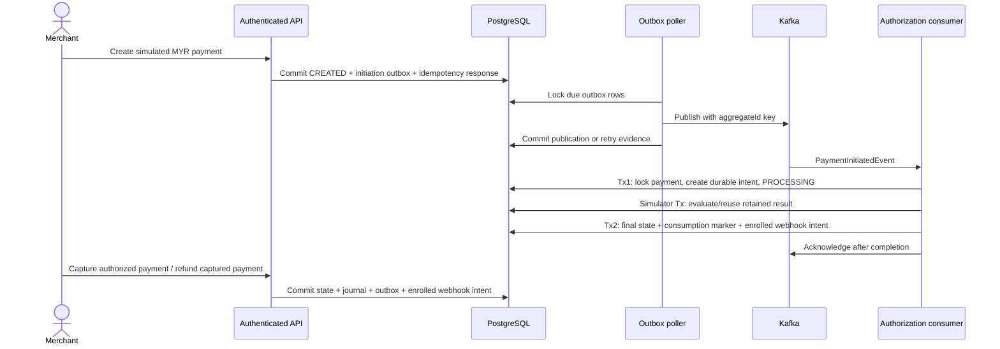

# KaiPay architecture reality check

KaiPay is a modular Spring Boot application for simulated payments. This guide maps current implementation to its limits; source and tests establish specific behavior, not production availability, bank integration or certification.

## Implemented boundaries

| Area | Implementation and source | Limits |
| --- | --- | --- |
| Platform | Java 21, Spring Boot 4.1.1 in [backend/pom.xml](../backend/pom.xml). | One backend deployment unit; no demonstrated production capacity target. |
| Access | Individual accounts, server sessions, CSRF and merchant membership/resource checks; see [security](security.md). | No public signup or shared demo account. Sessions are in memory. ADMIN does not impersonate merchants. |
| Payment creation | [PaymentService](../backend/src/main/java/com/lky/kaipay/payment/service/PaymentService.java) commits payment, idempotency response and initiation outbox record together. | A committed payment can remain queued when Kafka is unavailable. |
| Outbox | [Publisher](../backend/src/main/java/com/lky/kaipay/outbox/service/OutboxEventPublisher.java) claims due rows with `FOR UPDATE SKIP LOCKED`, waits for each broker acknowledgment, and persists publication/retry evidence. | Duplicate publication is possible after broker acceptance but before database commit. No global FIFO or eventual-delivery guarantee. |
| Authorization | [AuthorizationRecoveryService](../backend/src/main/java/com/lky/kaipay/payment/service/AuthorizationRecoveryService.java) separates payment preparation/finalization from an independently committed [simulator transaction](../backend/src/main/java/com/lky/kaipay/payment/service/acquirer/SimulatedAuthorizationTransactionService.java). | Simulator and application share PostgreSQL. Durable local simulation is not external-bank idempotency. |
| Retry/DLT | [PaymentProcessingConsumer](../backend/src/main/java/com/lky/kaipay/payment/consumer/PaymentProcessingConsumer.java) uses retry topics and persists dead-letter diagnostics. | DLT routing does not prove rejection or mutate payment state. No replay mutation API or background recovery sweep. |
| Capture/refund | Synchronous service transactions commit state, [ledger journals](../backend/src/main/java/com/lky/kaipay/ledger/service/LedgerService.java) and outbox notifications together. Refunds lock the parent payment. | Financial activity is simulated; no clearing, payout or settlement. |
| Currency | New payment/account/journal activity is MYR, with integer minor units (100 sen = RM1.00). | Retained non-MYR history is not converted or relabelled. |
| Correlation | [CorrelationContext](../backend/src/main/java/com/lky/kaipay/common/observability/CorrelationContext.java) carries validated HTTP/outbox/Kafka identifiers and MDC context. | Diagnostic correlation is not W3C distributed tracing or an authorization/idempotency mechanism. |
| Webhooks | Atomic notification intents, HMAC signing, bounded delivery engine and merchant read-only visibility; see [webhooks](webhooks.md). | Application runtime accepts disabled mode only. External delivery remains inactive. |
| Authorization reconciliation | [Stored authorization reports](reconciliation.md) compare current payment and retained simulator evidence. | Operator creates runs; merchant/ADMIN pages read them. No accounting assessment or financial repair. |
| Internal accounting audit | [Standalone read-only CLI](internal-accounting-audit.md) checks retained capture/refund/journal relationships. | Transient operator report; no UI, HTTP endpoint, persistent report tables or fee-allocation certification. |

## Payment and messaging lifecycle

Preparation, simulator evaluation and finalization are separate transactions. A crash after the simulator result commits can leave the payment PROCESSING. A later valid delivery can reuse that result and finalize without creating another simulator outcome. An unresolved historical PROCESSING payment without durable intent is quarantined rather than guessed. Retry exhaustion alone leaves an unresolved authorization unresolved; see [failure handling](failure-handling-and-retries.md).

Capture/refund notifications share the Kafka transport but are acknowledged and skipped by the authorization consumer. Their accounting has already committed; they do not ask that consumer to post journals or authorize again. Refund events use the refund UUID as their partition key, so they need not share the payment's partition.

## Outbox scheduling and delivery evidence

The [repository query](../backend/src/main/java/com/lky/kaipay/outbox/repository/PaymentEventOutboxRepository.java) selects PENDING rows whose retry time is due, ordered by `COALESCE(next_attempt_at, created_at), created_at, id`. Defaults are a 500ms poll interval, batch size 20 and a 4-second per-send wait. Sends are sequential inside the poller transaction; this is not asynchronous batch publishing.

`SKIP LOCKED` skips rows held by competing transactions. It does not eliminate all database contention or impose global processing order. The [V6 partial index](../backend/src/main/resources/db/migration/V6__add_outbox_retry_scheduling.sql) supports due-row selection; it does not establish throughput at millions of rows. Retryable publication failures retain eligibility with exponential delay capped at 60 seconds by default. A record-too-large rejection is quarantined for operator remediation.

## Evidence and deployment status

Focused source-backed regressions include [durable authorization recovery](../backend/src/test/java/com/lky/kaipay/payment/AuthorizationRecoveryIntegrationTest.java), [gateway redelivery](../backend/src/test/java/com/lky/kaipay/payment/consumer/PaymentGatewayRedeliveryIntegrationTest.java), [partition progress](../backend/src/test/java/com/lky/kaipay/payment/consumer/PaymentHeadOfLinePartitionIntegrationTest.java), [outbox outage recovery](../backend/src/test/java/com/lky/kaipay/outbox/service/OutboxKafkaOutageIntegrationTest.java) and [ledger invariants](../backend/src/test/java/com/lky/kaipay/ledger/service/LedgerFinancialInvariantsIntegrationTest.java). Their assertions cover bounded scenarios, not universal fault tolerance.

Flyway currently includes V1–V11: core schema, synthetic merchants, outbox, consumption/DLT records, ledger, outbox retry scheduling, identities, durable simulator operations, MYR defaults, webhooks and authorization reports. The transient internal accounting audit adds no migration. Inspect the [migration directory](../backend/src/main/resources/db/migration) for exact SQL.

The project has been demonstrated locally under operator supervision. Oracle hosting remains postponed; there is no public hosted demo or availability claim. A deployment needs separate operational validation and authorization. Redis, DLT replay, real acquirer integration and settlement are not delivered capabilities.
